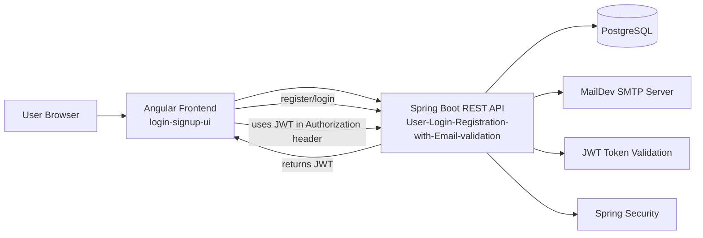
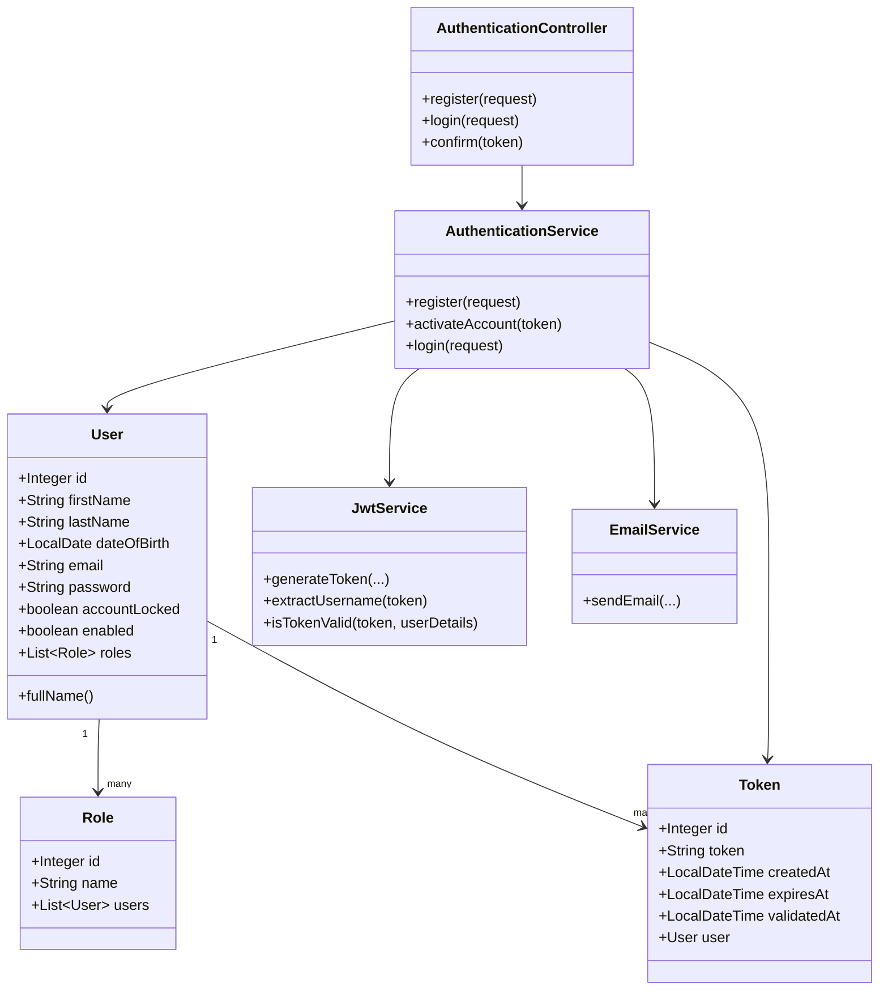
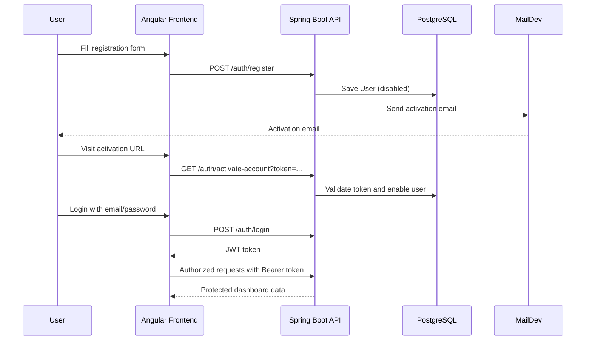
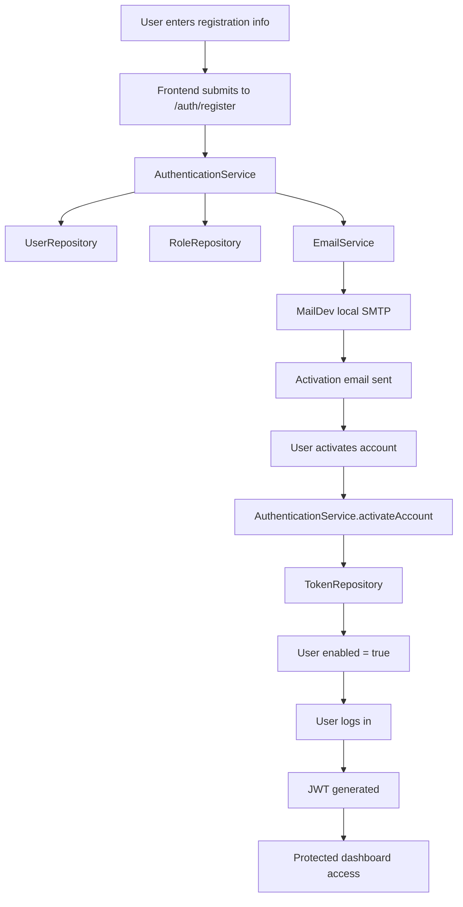

# User Login & Registration with Email Validation

This repository contains a full-stack authentication system built with:

- Spring Boot 3 (Java 17) for the REST API
- Angular 16 for the frontend UI
- PostgreSQL for database persistence
- MailDev for local email testing
- JWT for stateless authentication
- Spring Security for authorization and authentication

The project implements user registration, login, JWT-based session management, and email account activation.

## 1. Project Goals

The application allows a user to:

- create an account with first name, last name, email, and password
- receive an activation token by email
- activate the account through a verification link or code
- log in securely with JWT
- access protected dashboard routes after authentication
- use a modern dashboard UI after successful login

## 2. Architecture Overview

The system is split into two main parts:

1. Backend API
   - resides in `User-Login-Registration-with-Email-validation/`
   - built with Spring Boot, JPA, Security, Mail, and JWT
   - exposes REST endpoints for `/auth/register`, `/auth/login`, and `/auth/activate-account`

2. Frontend Application
   - resides in `login-signup-ui/`
   - built with Angular
   - handles user registration, login, email verification, and dashboard navigation

A PostgreSQL database stores users, roles, and activation tokens. MailDev is used locally to simulate email delivery for activation messages.



## 3. High-Level System Design



## 4. Main Backend Modules

The backend project directory structure is:

```text
User-Login-Registration-with-Email-validation/
├── src/
│   ├── main/
│   │   ├── java/com/yessinCoding/
│   │   │   ├── auth/
│   │   │   │   ├── AuthenticationController.java
│   │   │   │   ├── AuthenticationService.java
│   │   │   │   ├── AuthenticationResponse.java
│   │   │   │   ├── LoginRequest.java
│   │   │   │   └── RegistrationRequest.java
│   │   │   ├── config/
│   │   │   │   └── BeansConfig.java
│   │   │   ├── email/
│   │   │   │   ├── EmailService.java
│   │   │   │   └── EmailTemplateName.java
│   │   │   ├── entity/
│   │   │   │   ├── User.java
│   │   │   │   └── Token.java
│   │   │   ├── handler/
│   │   │   │   ├── BusinessErrorCodes.java
│   │   │   │   ├── ExceptionResponse.java
│   │   │   │   └── GlobalExceptionHandler.java
│   │   │   ├── repository/
│   │   │   │   ├── RoleRepository.java
│   │   │   │   ├── TokenRepository.java
│   │   │   │   └── UserRepository.java
│   │   │   ├── role/
│   │   │   │   └── Role.java
│   │   │   ├── security/
│   │   │   │   ├── JwtAuthFilter.java
│   │   │   │   ├── JwtService.java
│   │   │   │   ├── SecurityConfig.java
│   │   │   │   └── UserDetailsServiceImpl.java
│   │   │   └── UserLoginRegistrationWithEmailValidationApiApplication.java
│   │   └── resources/
│   │       ├── application.yml
│   │       ├── application-dev.yml
│   │       └── templates/
│   │           └── activate_account.html
│   └── test/
│       └── java/com/yessinCoding/
│           └── UserLoginRegistrationWithEmailValidationApiApplicationTests.java
├── pom.xml
├── mvnw
├── mvnw.cmd
├── .mvn
└── .gitignore
```

### 4.1 Authentication Layer

The backend uses Spring Security and JWT to protect endpoints.

- `SecurityConfig` defines public routes and secured routes
- `JwtAuthFilter` reads the `Authorization: Bearer ...` header
- `JwtService` creates and validates tokens
- `UserDetailsServiceImpl` loads the user from the database for authentication

Important behavior:

- endpoints under `/auth/**` are public
- everything else requires authentication
- a JWT is generated after successful login and included in subsequent requests

### 4.2 Domain Model

#### User entity
The `User` entity represents a user account in the application.

Fields include:

- `id`
- `firstName`
- `lastName`
- `dateOfBirth`
- `email`
- `password`
- `accountLocked`
- `enabled`
- `roles`
- `createdAt`
- `lastModified`

It implements `UserDetails`, which allows Spring Security to treat the user as an authenticated principal.

#### Role entity
The `Role` entity stores the user roles. The current app creates a default role named `USER` when the backend starts.

#### Token entity
The `Token` entity stores activation tokens used to verify account ownership.

Each token contains:

- the generated code/token
- creation time
- expiration time
- validation time
- the user it belongs to

### 4.3 Authentication Flow

#### Registration process
`AuthenticationController.register()` accepts `RegistrationRequest` and calls `AuthenticationService.register()`.

The service:

1. finds the default `USER` role
2. creates a new `User` with encrypted password
3. marks the account as disabled until email activation
4. saves the user
5. generates a verification token
6. sends an email using `EmailService`

#### Email activation
When the user clicks the activation link or enters the activation code:

1. the backend receives a token
2. `AuthenticationService.activateAccount(token)` loads the token from the database
3. checks if it expired
4. enables the user account
5. marks the token as validated

#### Login process
On login:

1. `AuthenticationManager` authenticates the email and password
2. `JwtService` creates a JWT token
3. the token is returned to the frontend in the response body
4. the frontend stores it and forwards it in the `Authorization` header for protected endpoints

## 5. Frontend Application

The Angular app is in `login-signup-ui/`.

### Main frontend structure

```text
login-signup-ui/
├── src/
│   └── app/
│       ├── guards/
│       │   └── auth.guard.ts
│       ├── modules/
│       │   └── dashboard/
│       │       ├── dashboard/
│       │       ├── main-dashboard/
│       │       ├── body/
│       │       ├── settings/
│       │       ├── users/
│       │       ├── products/
│       │       ├── orders/
│       │       └── profile/
│       ├── pages/
│       │   ├── login/
│       │   ├── register/
│       │   └── activate-account/
│       ├── app-routing.module.ts
│       ├── app.module.ts
│       └── app.component.*
├── angular.json
├── package.json
├── tsconfig.json
└── README.md
```

### Frontend routes

The app configures these routes in `app-routing.module.ts`:

- `/login` → login screen
- `/register` → new account registration screen
- `/activate-account` → email activation page
- `/dashboard` → protected dashboard home
- `/dashboard/users`
- `/dashboard/products`
- `/dashboard/orders`
- `/dashboard/settings`

`authGuard` protects the dashboard area so only authenticated users can access it.

### Frontend flow



## 6. Security Architecture

The application secures the backend with Spring Security.

### Security responsibilities

- password encoding via `BCryptPasswordEncoder`
- JWT validation for protected routes
- custom `JwtAuthFilter` for parsing bearer tokens
- public access to Swagger and auth routes
- all other routes require authentication

### Security configuration summary

```text
Public endpoints:
- /auth/register
- /auth/login
- /auth/activate-account
- Swagger endpoints

Protected endpoints:
- all other API endpoints
```

## 7. Database and Infrastructure

The repository includes `docker-compose.yml` to run infrastructure dependencies locally.

### Services in docker-compose

- PostgreSQL on port `5433` (mapped from container port `5432`)
- MailDev on ports `1025` and `1080`

This makes it easy to run the app without installing extra external services in the developer environment.

## 8. Technologies Used

### Backend

- Java 17
- Spring Boot 3.1.0
- Spring Web
- Spring Data JPA
- Spring Security
- PostgreSQL JDBC
- JJWT for JWT handling
- SpringDoc OpenAPI
- Thymeleaf for email templates
- Lombok

### Frontend

- Angular 16
- TypeScript
- Bootstrap 5
- RxJS
- Angular Router
- FontAwesome

## 9. Configuration Files

### Backend app config

- `application.yml` — general application configuration
- `application-dev.yml` — local development database and mail settings

### Important values in `application-dev.yml`

- database URL: `jdbc:postgresql://localhost:5432/login_register`
- database credentials: `postgres / Rayana2024`
- mail server: `localhost:1025`
- JWT secret key and expiry duration are configured there
- frontend activation URL: `http://localhost:4200/activate-account`

## 10. Running the Project

### 1. Start infrastructure

From the repository root:

```bash
docker-compose up -d
```

This starts:

- PostgreSQL
- MailDev

### 2. Run the backend

```bash
cd "User-Login-Registration-with-Email-validation"
./mvnw spring-boot:run
```

The API will be available at:

- `http://localhost:8080/api/v1`
- Swagger UI: `http://localhost:8080/api/v1/swagger-ui.html`

### 3. Run the frontend

```bash
cd login-signup-ui
npm install
npm start
```

The Angular app runs at:

- `http://localhost:4200`

## 11. Typical User Journey

1. User registers with full name + email + password
2. API creates a disabled user and sends an activation email
3. User opens the activation URL in the frontend
4. Backend verifies the token and enables the account
5. User logs in
6. Backend returns JWT
7. Frontend stores JWT and allows access to the protected dashboard

## 12. Summary

This repository is a complete example of:

- secure user registration
- email verification
- JWT authentication
- full-stack Java + Angular integration
- REST API design with Spring Security
- local infrastructure orchestration with Docker Compose

It is a strong example of a modern authentication flow that can be extended with features like:

- password reset
- account lockout policies
- user profile management
- role-based access control (RBAC)
- refresh tokens
- OAuth2 login

## 13. Useful Links

- Backend app: `User-Login-Registration-with-Email-validation/`
- Frontend app: `login-signup-ui/`
- Docker configuration: `docker-compose.yml`
- Swagger UI: `http://localhost:8080/api/v1/swagger-ui.html`
- MailDev UI: `http://localhost:1080`

## 14. UML / Sequence Summary



This README documents the architecture and the main flow of the project from both the backend and frontend perspectives.
